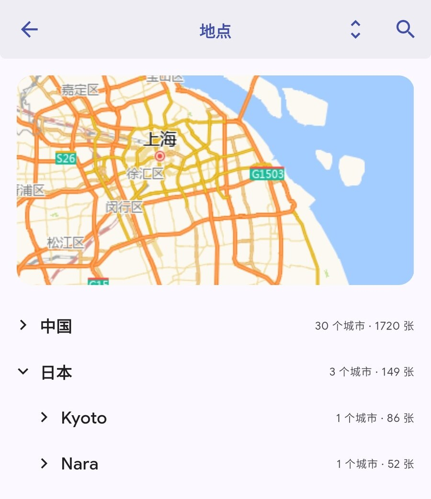

# Immich · yunshang build（非官方 Android 构建）

<p>
  <a href="LICENSE"></a>
  <a href="https://github.com/whxciotw/immich-app/releases/latest"></a>
  
</p>

> **这不是 Immich 官方项目。**
>
> 本仓库是 [immich-app/immich](https://github.com/immich-app/immich) 的 fork，
> 只用于发布个人自用的 Android APK。服务器端请使用官方镜像与文档：
> <https://immich.app> / <https://docs.immich.app>。

## 这个构建和官方 App 有什么区别

| 项 | 官方 App | 本仓库（yunshang build） |
| --- | --- | --- |
| Places 地图初始位置 | 写死夏威夷 / `(0,0) zoom 0` | 设备最近位置 → 相册分布范围 → 中性视野 |
| Places 列表 | 平铺城市 | **国家 → 省 → 市 三级折叠**，默认展开国家，支持全部展开/折叠、搜索、按名称排序、显示照片数量 |
| 人物管理 | 仅网页端 | 选择人物封面、合并人物、隐藏/显示人物、查看已隐藏人物 |
| 相册封面 | 仅网页端 | 相册 → 选项 → 选择封面照片 |
| 更新来源 | Play Store / F-Droid / App Store | 本仓库 **GitHub Releases**（App 内检查/下载/安装 + Obtainium） |
| 包名 | `app.alextran.immich` | `app.alextran.immich.yunshang`（可与官方共存） |
| 桌面名称 | `Immich` | `Immich`（同名，按包名区分） |

## 截图

<p align="center">
  
</p>

<p align="center"><em>地点页：国家 → 省 → 市三级折叠，默认展开国家，可全部展开/折叠、搜索，按名称排序。</em></p>

## 下载与安装

- 最新版本：<https://github.com/whxciotw/immich-app/releases/latest>
- 多数手机选 `arm64-v8a`；不确定机型选 `universal`。
- 首次安装需要允许"安装未知应用"；官方 Immich 可以保留（桌面会出现两个同名图标，可按包名区分）。
- 签名证书 SHA-256：[`yunshang/SIGNING_CERT_SHA256.txt`](yunshang/SIGNING_CERT_SHA256.txt)

  ```
  50:64:5F:E3:2B:CF:18:06:BA:AF:4D:38:90:A1:23:D0:84:D8:7C:0F:BB:5A:3F:B3:F6:50:A6:B9:A2:05:9D:CF
  ```

  可用 `apksigner verify --print-certs <apk>` 或手机上的 APK 校验工具核对；指纹不一致请不要安装。

## 更新

- **App 内更新**：Settings → Advanced → `启动时检查更新`（默认开）/ `自动下载更新包`（默认关）/
  `立即检查更新`（手动，绕过节流与"忽略此版本"）。
  发现新版本后会下载并拉起 Android 系统安装器。普通 App 无法静默安装，最后一步需要你点"安装"确认。
- **Obtainium**：用 [Obtainium](https://github.com/ImranR98/Obtainium) 添加本仓库即可跟踪 Releases。
- 不要从 Play 商店更新官方 Immich 来更新本 App：包名和签名都不同。

## 自动构建

上游每发布一个 stable 版本，GitHub Actions 会自动：

1. 找到最新 stable tag（12h debounce）；
2. merge 进 `main`（冲突会自动开 issue）；
3. 用该 tag 固定的 Flutter/JDK 工具链构建 4 个 APK；
4. 校验签名指纹、包名、versionCode；
5. 发布 `vX.Y.Z-yunshang.N`（APK + `latest.json` + `sha256sums.txt`）。

细节见 [YUNSHANG.md](YUNSHANG.md)。如果 fork 的定时任务没有触发（GitHub 对 fork 的 schedule 默认可能关闭），
到 `Actions → Sync upstream and build APK → Run workflow` 手动运行一次即可。

## 相关项目

| 项目 | 作用 |
| --- | --- |
| **本仓库** `immich-app` | 非官方 Android 构建（APK） |
| [whxciotw/immich-amap](https://github.com/whxciotw/immich-amap) | 高德底图样式、GCJ-02 纠偏、中文地名库、通用 Docker 部署 |
| [whxciotw/immich](https://github.com/whxciotw/immich) | 两个项目的门户/文档索引与版本兼容说明 |

## 许可与声明

- 上游 Immich 使用 **AGPL-3.0**，见 [LICENSE](LICENSE)；本仓库保持公开并保留上游许可证与版权声明。
- 本构建是**非官方构建**，与 Immich 项目没有隶属关系。请勿将其当作官方版本传播或用于商业转售。
- 上游源码与文档：<https://github.com/immich-app/immich> · <https://docs.immich.app>

## English

Unofficial Android build of Immich (fork of [immich-app/immich](https://github.com/immich-app/immich)):

- country/province/city collapsible tree on the Places page, device-location fix for the map;
- separate application id `app.alextran.immich.yunshang` (installs next to the official app);
- in-app updates from this repository's GitHub Releases.

Download from [Releases](https://github.com/whxciotw/immich-app/releases/latest).
Not affiliated with the Immich project. AGPL-3.0.
